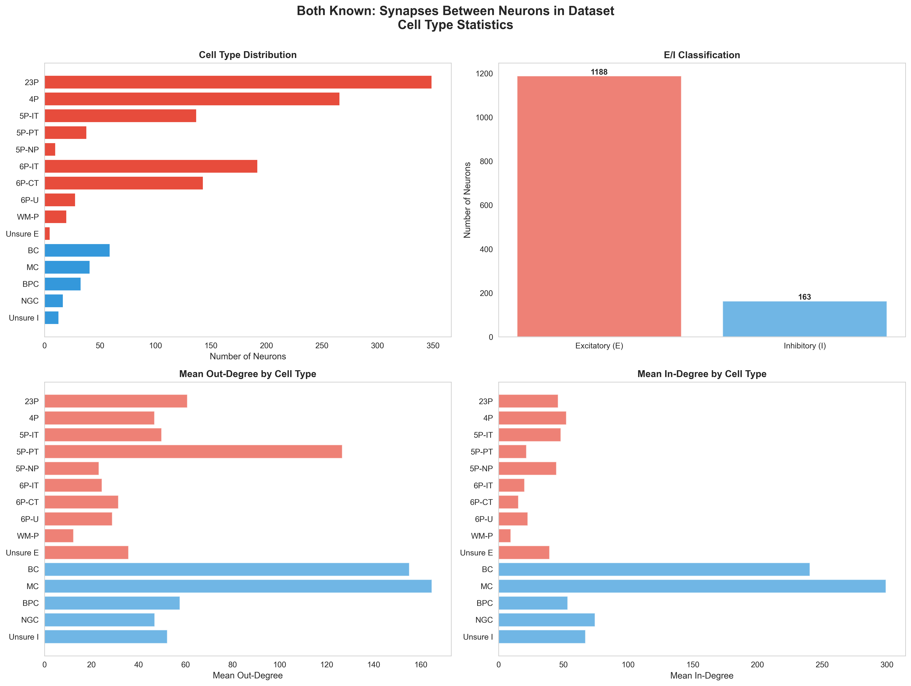
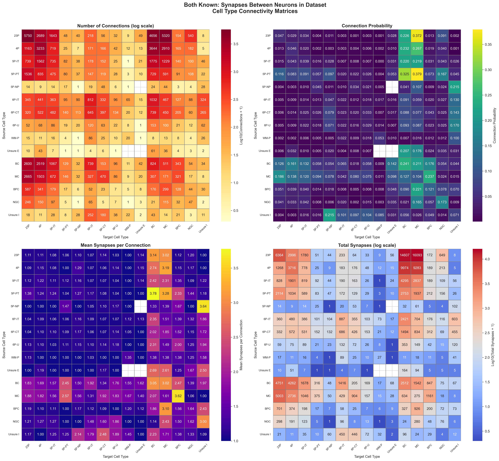
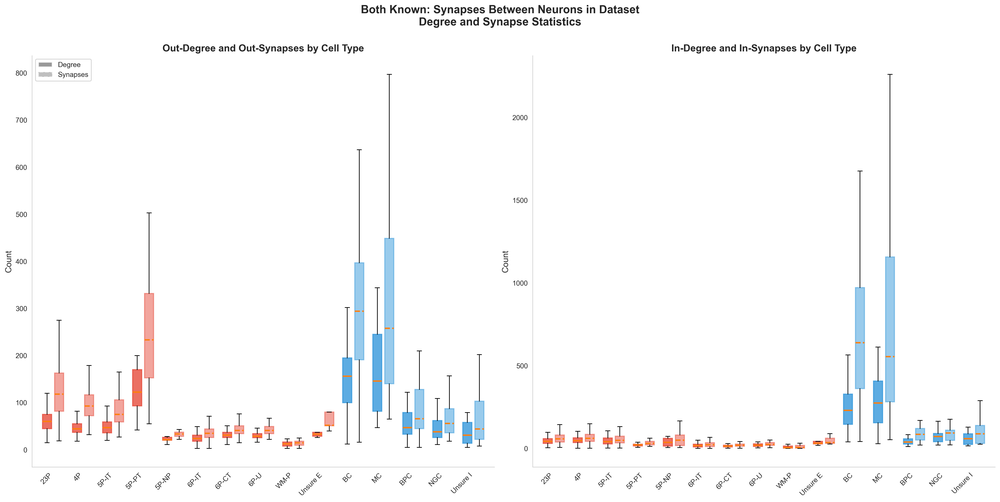
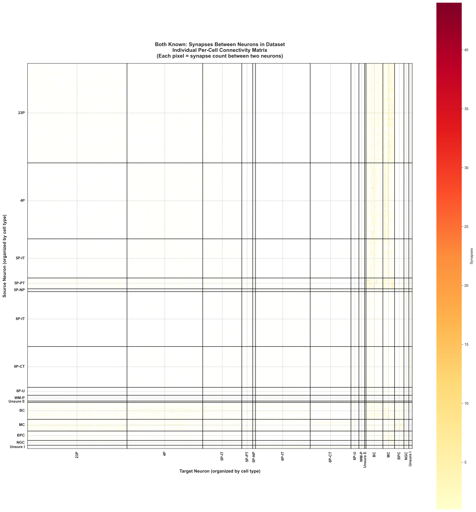
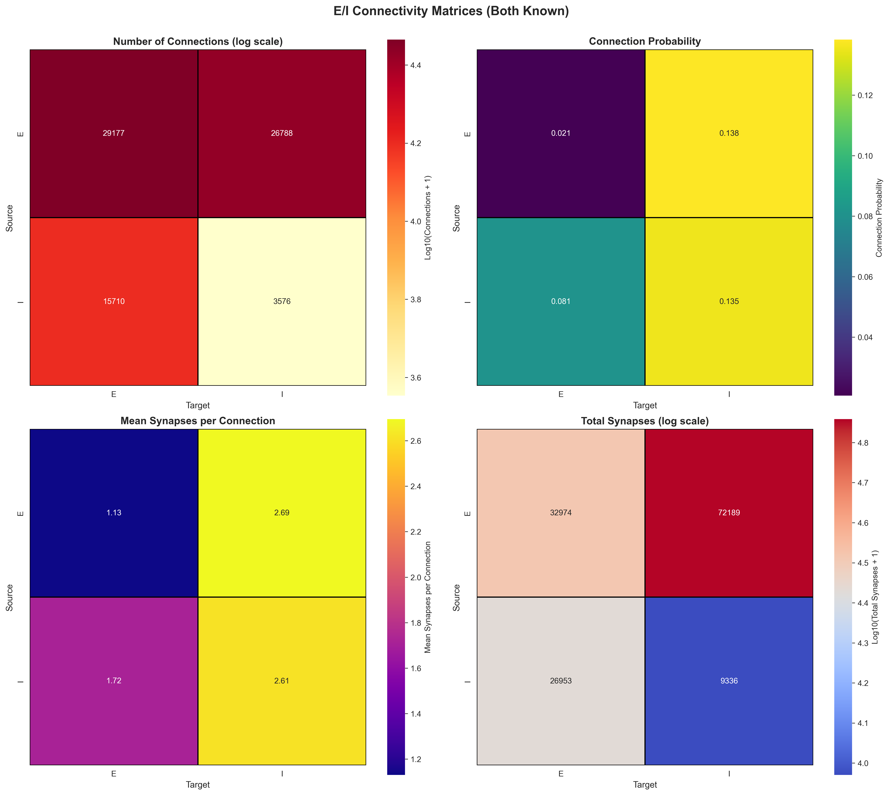
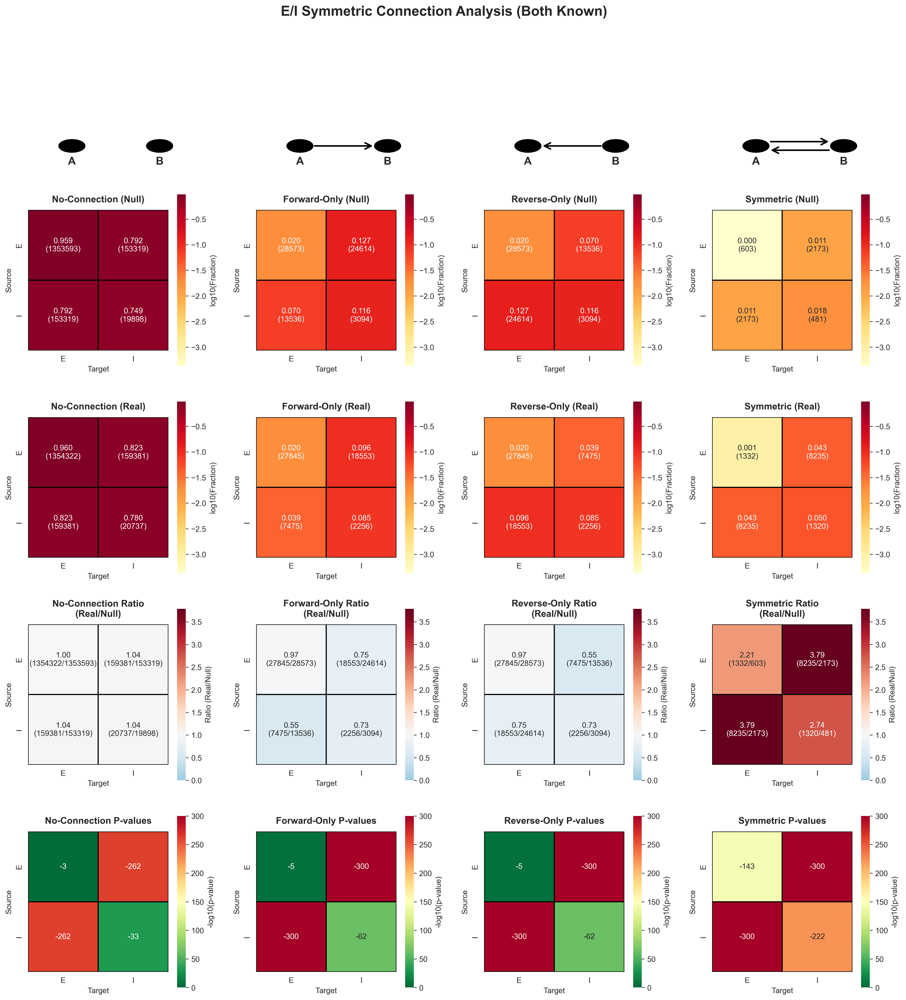
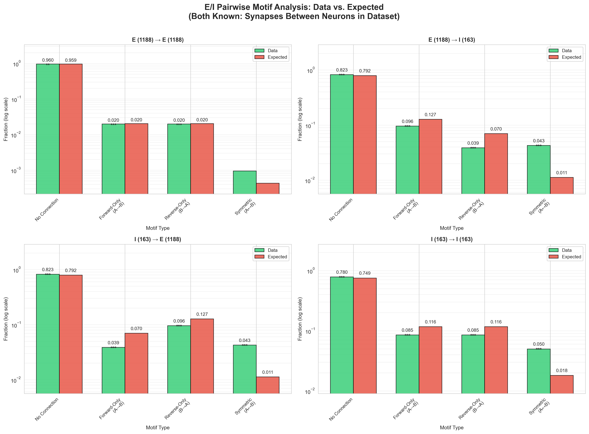

# minicolumn: connectivity of a proofread MICrONS minicolumn

Connectivity analysis of a **100 × 100 µm minicolumn** in the MICrONS mouse visual cortex dataset (minnie65). The results are exported as constraints for a spiking recurrent network model.

Axonal connectivity in the full MICrONS volume (about 70K neurons, 13M neuron-to-neuron synapses) is unreliable without extra proofreading. So this analysis uses the minicolumn subnetwork instead, where the cells have been proofread. It contains **1,351 neurons** (1,188 excitatory, 163 inhibitory) of 15 cell types: 23P, 4P, 5P-IT/PT/NP, 6P-IT/CT/U, WM-P, BC, MC, BPC, NGC and two "unsure" classes.

This was joint work with Dean Geckt in the Idan Segev lab. Dean's MICrONS analysis code is in [deangeckt/Dendro-Synaptome](https://github.com/deangeckt/Dendro-Synaptome).

## Analyses

- **Cell types and degrees.** Counts per cell type, plus in-degree and out-degree distributions (`LoadData.py`).
- **Cell-type connectivity matrices.** Connection probability and synapse counts between every pair of cell types.
- **Three cases**, depending on how much of each synapse's identity is known (`AnalyzeAllCases.py`):
  - `both_known`: presynaptic and postsynaptic cell are both in the column;
  - `post_known`: inputs to column cells from any source;
  - `pre_known`: outputs of column cells to any target.
- **Pairwise and reciprocal motifs.** Counts of each connection pattern between two cells (one-way either direction, reciprocal, or none), compared with what independent connections would predict. Significance comes from binomial tests with Clopper–Pearson confidence intervals (`AnalyzePairwiseMotifs.py`, `AnalyzeSymmetricConnections.py`).
- **E/I summary.** The same analyses pooled into E→E, E→I, I→E and I→I (`AnalyzeEI_Aggregate.py`).
- **Export to a network model.** `ExportConnectomeToSSRNN.py` writes the measured cell-type populations and connection probabilities to a JSON config (`connectome_ssrnn_config.json`, `connectome_ssrnn_stats.json`) that a spiking recurrent network simulator reads.

## Figures

**Cell types and degree distributions.**


**Cell-type connectivity matrices** (connection probability and synapse counts).


**Degree statistics by cell type.**


**Cell-by-cell connectivity matrix**, sorted by cell type.


**Two-cell motifs** compared with chance (binomial tests).


**E/I summary**: connectivity, one-way vs. reciprocal connections, and motifs.




## Files

| File | Purpose |
|---|---|
| `LoadData.py` | Load the sparse synapse matrix and neuron table; basic figures |
| `AnalyzeAllCases.py` | Full analysis for the `both_known`, `post_known` and `pre_known` cases |
| `AnalyzePairwiseMotifs.py` | Two-cell motif statistics |
| `AnalyzeSymmetricConnections.py` | Reciprocal vs. one-way connection analysis |
| `AnalyzeEI_Aggregate.py` | E/I-pooled matrices, symmetry, motifs and degrees |
| `ExportConnectomeToSSRNN.py` | Export connectivity to a spiking-network config |
| `check_synapses.py` | Check that matrix degrees agree with the neuron table |
| `network_synapses_matrix.npz`, `network_synapses_mapping.pkl` | Sparse neuron × neuron synapse-count matrix and its index-to-`root_id` mapping |
| `connectome_neurons.csv` | Per-neuron metadata: cell type, E/I class, morphology, synapse counts and weights |
| `figures/` | Output figures, one folder per case |

## Running

```bash
pip install numpy scipy pandas matplotlib seaborn
python AnalyzeAllCases.py
python AnalyzeEI_Aggregate.py
python ExportConnectomeToSSRNN.py
```

Run the scripts from the repository root. They load the data files in it.

## Author

[Toviah Moldwin](https://toviahmoldwin.com). Idan Segev lab, ELSC, Hebrew University of Jerusalem.
